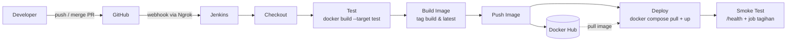
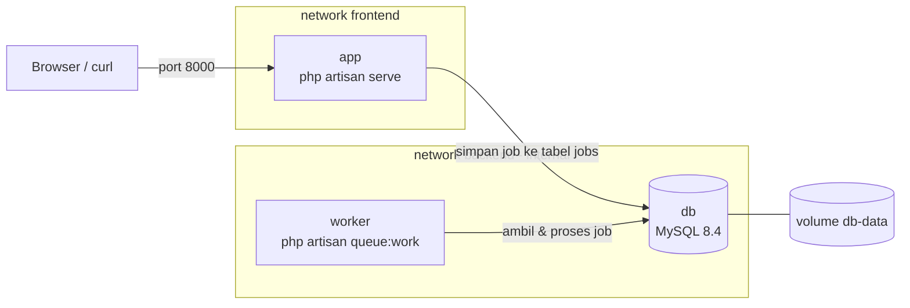

# KosanHub

Platform pengelolaan kos-kosan untuk pemilik dengan banyak unit kamar: data properti & kamar, penyewa & kontrak sewa, tagihan bulanan otomatis, pencatatan pembayaran, dan daftar tunggakan.

Tugas Besar 1 Komputasi Awan: DevOps CI/CD Pipeline Jenkins (studi kasus K12).

## Anggota Kelompok

| Nama | NIM | Peran |
|---|---|---|
| _isi nama_ | _isi NIM_ | Tech Lead / Backend |
| _isi nama_ | _isi NIM_ | DevOps Engineer |
| _isi nama_ | _isi NIM_ | Container Engineer |
| _isi nama_ | _isi NIM_ | QA Engineer & Tech Writer |

## Stack

- **Aplikasi:** Laravel 13 (PHP 8.3), REST API + halaman ringkasan sederhana
- **Database:** MySQL 8.4 (test otomatis memakai SQLite in-memory)
- **Antrean:** Laravel Queue driver `database`, diproses oleh container worker
- **Container:** Docker multi-stage build, Docker Compose
- **CI/CD:** Jenkins (Pipeline script from SCM) + GitHub webhook via Ngrok, image di Docker Hub

## Arsitektur

### Alur pipeline



### Arsitektur container



`app` dan `worker` memakai **image yang sama** (`<user>/kosanhub:latest`) dengan perintah berbeda. Hanya `app` yang membuka port ke host; `db` dan `worker` hanya ada di network `backend` (`internal: true`).

## Fitur & Endpoint

| Method | Endpoint | Keterangan |
|---|---|---|
| GET | `/health` | Status aplikasi & koneksi database (200 / 503) |
| GET | `/` | Halaman ringkasan: statistik, tunggakan, proses tagihan terakhir |
| CRUD | `/api/properties` | Properti kos |
| CRUD | `/api/rooms` | Kamar (`?property_id=`) |
| CRUD | `/api/tenants` | Penyewa |
| GET/POST | `/api/contracts` | Daftar & buat kontrak sewa |
| POST | `/api/contracts/{id}/end` | Akhiri kontrak |
| POST | `/api/invoice-runs` | Picu pembuatan tagihan bulanan (`{"periode":"2026-12"}`, default bulan ini), diproses worker, balas 202 |
| GET | `/api/invoice-runs/{id}` | Status proses: PENDING → PROCESSING → DONE/FAILED |
| GET | `/api/invoices` | Daftar tagihan (`?periode=`, `?status=`, `?contract_id=`) |
| POST | `/api/invoices/{id}/payments` | Lunasi tagihan (`{"metode":"TRANSFER","tanggal_bayar":"2026-12-05"}`) |
| GET | `/api/arrears` | Daftar tunggakan beserta denda berjalan |

## Aturan Bisnis

| Aturan | Implementasi |
|---|---|
| Satu kamar hanya untuk satu kontrak aktif | `ContractService::create()` (lock baris kamar) + index unik `contracts.active_room_id` |
| Tagihan bulan pertama proporsional sesuai tanggal masuk | `BillingCalculator::prorate()`: harga × (hari ditempati, termasuk tanggal masuk) / jumlah hari bulan itu |
| Denda keterlambatan 2% per minggu, maksimal 10% | `BillingCalculator::lateFeePercent()` |
| Tagihan bulanan tidak terbit dua kali untuk periode yang sama | `InvoiceGenerator` (cek + index unik `invoices(contract_id, periode)`) |

Asumsi yang kami tetapkan:
- Jatuh tempo = tanggal terbit + 7 hari. Tagihan reguler terbit tanggal 1; tagihan bulan pertama terbit di tanggal masuk.
- Minggu keterlambatan dibulatkan ke atas: telat 1–7 hari = 2%, 8–14 hari = 4%, … maksimal 10%.
- Denda dan total dihitung server saat pembayaran; nilai dari klien diabaikan.
- Pembayaran selalu melunasi satu tagihan penuh.

## Test Otomatis

Jalankan: `php artisan test` (lokal) atau otomatis di stage **Test** Jenkins (`docker build --target test`).

| File | Yang diuji |
|---|---|
| `tests/Unit/BillingCalculatorTest.php` | **Aturan bisnis** prorata & denda 2%/minggu maks 10% (termasuk batas minggu ke-1/ke-2 dan batas maksimal) |
| `tests/Feature/ContractRuleTest.php` | **Aturan bisnis** satu kamar satu kontrak aktif, kamar bisa disewa lagi setelah kontrak diakhiri |
| `tests/Feature/InvoiceGenerationTest.php` | **Aturan bisnis** tagihan tidak terbit dua kali, prorata bulan pertama, job masuk antrean & diproses worker |
| `tests/Feature/PaymentAndArrearsTest.php` | **Aturan bisnis** denda dihitung server, tagihan lunas tidak bisa dibayar ulang, daftar tunggakan |
| `tests/Feature/PropertyRoomApiTest.php` | CRUD & validasi properti/kamar |
| `tests/Feature/HealthCheckTest.php` | `/health` 200 + status database, halaman utama |

## Menjalankan Secara Lokal

### Tanpa Docker (untuk development & test)

```bash
composer install
cp .env.example .env
php artisan key:generate
php artisan test
```

### Dengan Docker Compose

```bash
cp .env.example .env
# isi APP_KEY (php artisan key:generate --show), DOCKERHUB_USER, dan password database di .env
docker build -t <user-dockerhub>/kosanhub:latest .
docker compose up -d
docker compose ps
curl http://localhost:8000/health
```

Biasanya image tidak perlu di-build manual: pipeline Jenkins yang membangun dan mem-push image ke Docker Hub, lalu `docker compose pull`.

Perintah berguna:

```bash
docker compose logs -f worker        # lihat worker memproses job tagihan
curl -X POST http://localhost:8000/api/invoice-runs -H "Accept: application/json"
curl http://localhost:8000/api/arrears
```

## Setup Jenkins

1. Jalankan Jenkins sesuai Modul 2, pastikan agent bisa menjalankan `docker` dan `docker compose`.
2. Plugin: Git, GitHub, Pipeline, Credentials Binding (umumnya sudah ada di *suggested plugins*).
3. **Credentials** (Manage Jenkins → Credentials):
   - `dockerhub-credentials`: *Username with password* (username Docker Hub + Personal Access Token)
   - `kosanhub-env`: *Secret file* berisi `.env` production (format seperti `.env.example`)
   - `github-credentials`: *Username with password* (username GitHub + PAT), hanya jika repo private
4. Ubah `DOCKERHUB_USER` di `Jenkinsfile` dengan username Docker Hub kelompok.
5. Buat job **Pipeline** → *Pipeline script from SCM* → Git → URL repo, branch `*/main`, Script Path `Jenkinsfile`. Centang **GitHub hook trigger for GITScm polling**.
6. Jalankan Ngrok (`ngrok http 8080`, sebaiknya pakai domain statis gratis Ngrok supaya URL tetap). Di GitHub repo → Settings → Webhooks → Payload URL `https://<domain-ngrok>/github-webhook/`, content type `application/json`, event *Just the push event*.
7. Buat akun Jenkins khusus dosen (Manage Jenkins → Users), cantumkan di laporan.
8. Jika Jenkins berjalan di dalam container, ganti `SMOKE_URL` di `Jenkinsfile` menjadi `http://host.docker.internal:8000`.

## Uji Gagal–Pulih (Quality Gate)

1. Buat branch, ubah rumus di `BillingCalculator::prorate()` (misalnya hapus `+ 1`), buka PR, lalu merge.
2. Pipeline berhenti merah di stage **Test**; stage Deploy tidak jalan sehingga aplikasi versi lama tetap melayani (`/health` masih menampilkan versi build sebelumnya).
3. Kembalikan rumusnya lewat PR baru; pipeline hijau lagi dan versi baru ter-deploy.

## Alur Kolaborasi

- Branch `main` diproteksi: hanya bisa diubah lewat pull request (Settings → Branches → *Require a pull request before merging*).
- Nama branch: `feat/<fitur>`, `fix/<masalah>`, `test/<area>`, `docs/<bagian>`, `ci/<perubahan>`.
- Setiap PR di-review minimal satu anggota lain sebelum di-merge.
- Jangan pernah commit `.env`, token, atau password. Jika terlanjur, segera rotasi token tersebut.
